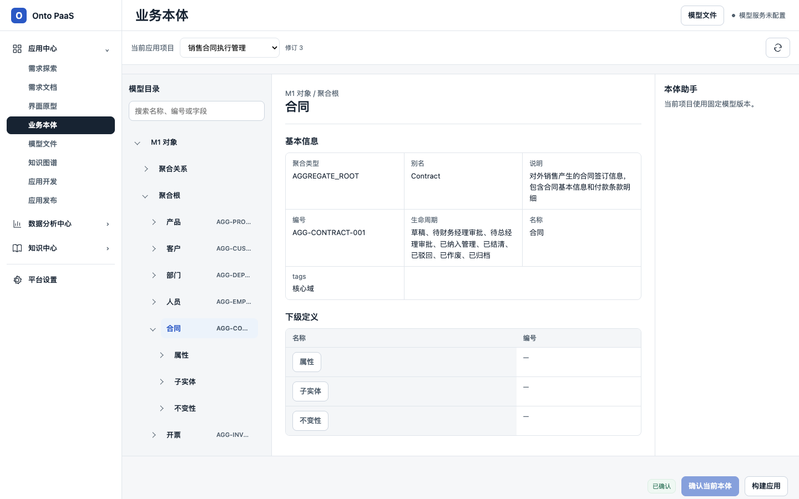
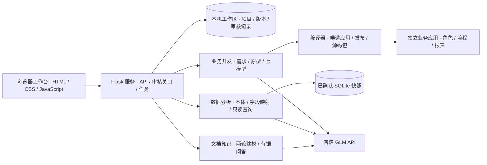

# Onto PaaS

**把业务需求和数据问题，落到可审核的本体模型与可运行的结果。**

[业务场景](#业务场景) · [应用开发](#应用开发如何工作) · [问数问因问策](#数据分析如何工作问数问因问策) · [技术架构](#技术架构) · [快速开始](#快速开始) · [开发与验证](#开发与验证)

Onto PaaS 是在本机运行的本体驱动应用平台。面对一项业务需求，可以从对话、需求文档或交互原型出发，确认规格和七个相互关联的模型，构建应用、验收候选版本并导出源码。面对一份业务数据，可以先确认 SQLite 数据快照的含义和字段映射，再提出经营问题，查看查询、计算、分析结论和来源。平台还提供文档知识整理与有据问答。

它适合希望把业务规则、数据口径和执行结果放在同一条可追溯链路里的人：业务负责人可以审核需求和验收结果，开发者可以检查模型与导出代码，分析人员可以核对指标、SQL 和原始数据。当前工作台是本机单人管理工具；生成的业务应用有自己的角色账号和权限。AI 功能需要配置智谱 GLM，相关任务内容会发送到所配置的模型服务。



## 为什么做 Onto PaaS

业务应用的开发常从一份需求说明开始，但真正影响运行结果的内容散落在流程图、表单、审批规则、角色权限和报表口径里。需求改动后，页面与后端规则是否仍对应，往往要靠人工逐处核对。数据分析也有类似问题：一句“为什么 GMV 下降了”，如果没有先确定订单状态、金额字段、时间范围和可比较的数据覆盖，结论就很难复核。

Onto PaaS 把两类工作放进同一个工作台，并让中间产物可见：应用开发保留从需求到原型、七模型、构建和发布的版本链；数据分析先确认数据本体与物理映射，再在受限的只读查询上形成报告。模型生成、查询计划和 AI 解释是候选结果，关键输入与产出由人审核。

## 业务场景

### 从销售合同需求构建应用

假设团队需要管理合同、付款阶段、分级审批、开票和收款。业务负责人先说明哪些金额需要上级审批、合同进入什么状态才能开票、不同岗位能看和改哪些信息。工作台将这些要求整理为规格与交互原型，之后映射到对象、行为、规则、角色、流程、报表和界面模型。

构建出的候选应用可以用角色账号实际操作。验收人员按合同创建、审批、开票、收款等用例核对页面和规则，通过后发布固定版本，也可以导出源码开发包，在独立环境中启动。仓库内置销售合同案例，便于沿完整流程体验。若已有七模型包，也可以导入后审核并构建。

### 对电商经营数据问数、问因、问策

分析人员上传 SQLite 快照，先确认订单、用户、渠道等表分别代表什么，哪些物理字段对应业务指标，再提出问题。例如“4 月 GMV 是多少”“相比 3 月变化在哪里”“下一步该核查什么”。

- **问数**：依据已确认的模型与字段映射生成只读查询，返回数值、统计、执行 SQL、参数和数据来源。时间范围与指标口径需要明确，报告以实际查询结果为证据。
- **问因**：把整体变化拆到有数据支持的维度。内置电商案例提供固定的 GMV 波动归因方法，按量价和下单渠道等步骤计算、对账，并标出当前数据不能证明的原因。
- **问策**：基于已经计算的事实列出可执行的核查方向，例如补查投放、流量、转化或退款资料。建议是待验证行动，不把相关性写成已证实的因果关系。

通用数据项目支持受约束的自然语言问数；固定电商案例另提供 GMV、经营异常和客户流失场景。GMV 归因流程依赖已确认的案例快照、模型与方法文档，并非任意 SQLite 数据都能直接运行同样的归因步骤。

### 把资料整理成可追溯知识

上传 Markdown 或纯文本资料后，工作台先提取并去重候选，再生成场景、概念和实体模型。用户分轮审核后，可以用确认的模型提问，查看检索链路与原文短引。资料或模型发生变更，需要重新确认对应结果。

## 产品设计

| 设计决策 | 在工作台中的体现 |
| --- | --- |
| 业务语义先于生成代码 | 需求、原型和七模型分别可审核；构建器从已确认模型生成可执行应用。 |
| 页面操作能追到业务规则 | MU 界面模型把控件和操作连到行为，再核对对象、规则、角色、流程与报表。 |
| 候选应用先验收再发布 | 构建产生候选版本，按实际角色和用例验收；候选发生变更后重新验收，发布固定当时的代码、模型和数据快照。 |
| 数据问题先确认口径 | 对 SQLite 结构建模并确认物理字段映射；报告展示 SQL、参数、来源和实际结果。 |
| 区分数据事实与行动建议 | 分析场景先执行受限查询与计算，再组织发现和核查建议；无法由快照证明的原因保持待验证。 |
| 原文和上游来源可回查 | 知识问答保留短引；随仓库分发的上游材料记录版本、摘要和各自许可。 |

## 应用开发如何工作

1. **输入和确认需求。** 创建业务应用项目，选择 V9 逐阶段确认或多轮澄清。可从对话开始，也可上传 Markdown、TXT 或带文本层的 PDF。生成的需求规格保留待确认项和自检证据，业务负责人审核后继续。
2. **预览交互原型。** 根据确认的需求生成原型，在工作台预览、修改并确认页面与操作。原型变更会使依赖它的后续产物失效，需要重新检查。
3. **审核七模型。** 逐份检查对象、行为、规则、角色、流程、报表和界面。界面调用链帮助核对“这个按钮由谁操作、触发什么行为、受什么规则约束、如何进入流程、最终进入哪张报表”。
4. **构建候选应用。** 编译器校验模型引用与可执行语义，生成应用所需的结构、界面和运行逻辑。候选应用的数据与工作台项目隔离，使用构建生成的角色账号进行操作。
5. **验收、发布和导出。** 在“应用发布”记录验收用例。通过后发布固定版本，或导出包含需求、原型、模型、DDL 和源码的开发包。跨版本业务数据迁移需要单独处理。

已有可移植模型时，可在空白项目的“开发配置”选择“导入七模型构建”，上传七份 YAML 与 `manifest.json`，再确认导入包中的 MU 界面基线与模型。内置销售合同案例可用于体验合同、付款阶段、分级审批、开票和收款联动。

## 数据分析如何工作：问数、问因、问策

1. **确定数据来源。** 上传 SQLite 快照，或选择已构建应用的业务数据快照。工作台检查真实表、字段、主键和外键，内部身份与审计表不作为分析来源。
2. **确认业务语义与映射。** 说明分析目标，生成并审核数据本体与物理字段映射。M1 定义分析对象，M2 定义行为，M3 定义口径和质量规则，M6 描述分析场景，M7 定义指标；实际表字段映射单独保存。也可导入现有的五份电商分析模型和 `data_mapping.yaml`。
3. **提问和核对结果。** 通用问数生成一条受限的只读 SQLite `SELECT`，展示结果、统计、SQL、绑定参数与来源。查询只允许已映射的表与字段，最多四个有完整外键依据的 JOIN，最多返回 500 行，查询预算为三秒。
4. **运行有方法约束的分析。** 固定电商案例在来源校验通过后，可运行 GMV、经营异常和客户流失分析。GMV 波动归因将方法文档、确认的快照和指标口径一同核对，按固定步骤计算并对账，再输出事实、覆盖范围与核查建议。

“问因”依赖数据能支持的拆解：订单数据可以展示金额变化来自哪些渠道或量价项，但单凭订单快照无法断言投放、产品或竞争环境造成变化。“问策”因此列出下一步要补充或核查的证据，而不是自动替用户作经营决策。

## 技术架构

浏览器访问本机 Flask 服务。服务保存项目、审核状态和任务结果，调用业务构建、数据分析和知识模块；只有需要理解或生成的步骤才调用配置的 GLM 接口。工作台前端随 Python 服务提供，不需要单独构建 Node.js 前端。默认数据保存在 `.local/paas/`，一个工作区同一时间由一个服务进程使用。



| 模块 | 主要职责 | 源码入口 |
| --- | --- | --- |
| 工作台与 API | 提供项目、审核、构建、分析、发布与任务接口；将页面请求分发到各领域模块。 | `paas/web/`、`paas/server.py` |
| 项目与任务存储 | 在本机工作区持久保存项目、版本和后台任务状态，并处理并发修订。 | `paas/store.py`、`paas/jobs.py` |
| 应用开发 | 整理需求、生成原型和模型，校验七模型及界面调用链。 | `paas/business.py`、`paas/prototype.py`、`paas/ontology.py`、`paas/callchain.py` |
| 构建与运行 | 将已验证模型编译为可执行应用；运行时处理角色权限、行为、流程与报表。 | `paas/builder.py`、`paas/app_runtime.py` |
| 数据分析 | 检查 SQLite 结构、确认映射、限制 SQL；固定场景执行统计和归因。 | `paas/analysis.py`、`paas/commerce_scenarios.py`、`paas/gmv_attribution.py` |
| 文档知识 | 两轮提取、模型审核、原文检索与有据问答。 | `paas/knowledge.py` |
| 模型服务 | 从服务端读取配置并调用 GLM，供需要 AI 的步骤使用。 | `paas/provider.py` |

### 七模型与数据流

业务应用与数据分析共享 `onto-paas-seven-v1` 文件格式：七份 YAML 加 `manifest.json`。两类项目复用模型语言，但执行路径不同；业务模型进入应用编译器，分析模型加上物理字段映射后进入受限查询。文档知识使用独立的场景、概念和实体模型。

| 模型 | 业务应用中的含义 | 数据分析中的含义 |
| --- | --- | --- |
| M1 | 对象、聚合与状态 | 分析对象与业务概念 |
| M2 | 业务行为 | 分析行为 |
| M3 | 业务规则与计算 | 指标口径与质量规则 |
| M5 | 角色与权限 | 保持为空 |
| M6 | 审批与业务流程 | 分析场景与步骤 |
| M7 | 报表与指标 | 指标与分析输出 |
| MU | 页面、控件与操作映射 | 保持为空 |

应用链路是“业务输入 → 需求与原型确认 → 七模型审核 → 编译与验收 → 发布版本或源码包”。数据链路是“SQLite 快照 → 数据本体与字段映射确认 → 受限查询或固定场景计算 → 带 SQL、来源和核查建议的报告”。两条链路都保留人工确认点，来源或模型变化后需要重新核对受影响的结果。

### 项目结构

```text
onto_paas/
├── paas/
│   ├── server.py             # Flask 入口、工作台 API 与审核流程
│   ├── web/                  # 工作台 HTML、CSS 与 JavaScript
│   ├── business.py           # 需求探索与业务模型生成
│   ├── prototype.py          # 交互原型
│   ├── ontology.py           # 本体模型基础能力
│   ├── builder.py            # 应用编译与源码包导出
│   ├── app_runtime.py        # 生成应用的角色、行为、流程和报表运行时
│   ├── analysis.py           # 数据映射与只读分析
│   ├── commerce_scenarios.py # 固定电商分析场景
│   ├── gmv_attribution.py    # GMV 波动归因
│   ├── knowledge.py          # 文档知识提取与问答
│   ├── provider.py           # 服务端 GLM 适配
│   ├── upstream/             # 固定版本的参考资料、源码与许可
│   └── tests/                # 回归测试与浏览器验证
├── docs/images/             # 工作台截图
└── requirements.lock.txt
```

## 快速开始

需要 **Python 3.11** 和 **macOS 或 Linux**。工作台由 Flask 提供服务，前端无需单独安装 Node.js 或构建。

```sh
git clone https://github.com/tomanojerry-debug/onto_paas.git
cd onto_paas

python3.11 -m venv .venv
.venv/bin/python -m pip install -r requirements.lock.txt
.venv/bin/python -m paas.server --port 4320
```

访问 [本体应用工作台](http://127.0.0.1:4320/)。默认数据目录为 `.local/paas/`，可通过 `--data-dir /path/to/workspace` 或 `PAAS_DATA_DIR` 改用其他目录。工作台默认只监听 `127.0.0.1`，用于本地单人管理。完整工作台依赖 Python 服务和可写工作区，GitHub Pages 无法运行该服务。

### 启用 GLM

启动和浏览工作台无需 API 密钥。需求对话、模型生成、自然语言分析和知识问答需要联网访问智谱 GLM。

```sh
cp .env.example .env.paas
chmod 600 .env.paas
```

在 `.env.paas` 中填入 `PAAS_API_KEY`，然后刷新工作台。同名进程环境变量优先。

| 配置项 | 用途 |
| --- | --- |
| `PAAS_API_KEY` | 智谱 API 密钥 |
| `PAAS_MODEL` | 模型名，默认 `glm-5.3-flash` |
| `PAAS_BASE_URL` | 智谱官方 HTTPS 接口，默认 `https://open.bigmodel.cn/api/coding/paas/v4` |

也可以通过 `PAAS_PROVIDER_CONFIG` 指定本地 JSON 配置，以 `credential_source` 和 `key_name` 从单独文件取密钥。相对凭据路径以配置文件所在目录为准。密钥由服务端读取。使用 AI 功能时，相关任务内容会随请求发送到配置的 GLM 服务。

## 开发与验证

运行离线回归测试。测试使用临时工作区和虚构资料，启动测试不需要模型凭据。

```sh
.venv/bin/python -m unittest discover -s paas/tests -v
```

浏览器验证需要安装 Google Chrome。夹具测试会自行启动服务，真实 HTTP 集成使用独立的临时工作区。

```sh
.venv/bin/python -m pip install -r requirements-browser.txt
.venv/bin/python -m paas.tests.ui_smoke --fixture
.venv/bin/python -m paas.tests.ui_http_integration
```

<details>
<summary>真实 GLM 和公开案例验证</summary>

以下命令使用已配置的 GLM，会产生 API 用量。先完成业务试验，再用同一试验目录验证完整链路。

```sh
.venv/bin/python -m paas.verify_live
.venv/bin/python -m paas.verify_final_chain
.venv/bin/python -m paas.verify_knowledge
```

业务试验和知识试验可以用 `--resume` 续跑。可用 `PAAS_VERIFY_DIR` 或 `PAAS_KNOWLEDGE_VERIFY_DIR` 为新一轮试验指定目录。

验证固定版本的合同和电商案例时，先根据 [来源清单](paas/upstream/sources.json) 检出对应的上游提交，再指定本地路径。附加 `--live-model` 会增加一次真实 GLM 电商用例。

```sh
.venv/bin/python -m paas.tests.verify_upstream_cases \
  --commerce-repo /path/to/Onto-DataAnalyse \
  --contract-repo /path/to/ontology-driven-dev \
  --output .local/verification/upstream-case-rerun
```

使用真实 GLM 验证合同助手和电商分析流程时，可运行 `.venv/bin/python -m paas.tests.verify_author_workflows --commerce-repo /path/to/Onto-DataAnalyse`。

</details>

## 许可证与参考

Onto PaaS 自行开发的代码采用 MIT 许可证。随仓库分发的第三方内容适用各自的许可和版权声明。[MIT 许可证](LICENSE)

Onto PaaS 参考人月聊 IT（sharptoolbox）的开源项目进行二次开发，将业务应用构建、数据分析和文档知识问答整合成一个新的本地 PaaS。

| 参考内容 | 上游项目 |
| --- | --- |
| V9 需求探索、交互原型、应用技术底座与合同案例 | [ontology-driven-dev](https://github.com/sharptoolbox/ontology-driven-dev) |
| 本体建模框架与七模型规范 | [ontology_modeling_framework](https://github.com/sharptoolbox/ontology_modeling_framework) |
| 数据建模、字段映射和电商分析案例 | [Onto-DataAnalyse](https://github.com/sharptoolbox/Onto-DataAnalyse) |
| 文档知识萃取与有据问答 | [LLM-knowledgeBase](https://github.com/sharptoolbox/LLM-knowledgeBase) |

上游清单记录引用的版本及原文件摘要。项目在 `ontology-driven-dev/SKILL.md` 中增加了工作台的原型生成指引。原始来源见 [上游来源清单](paas/upstream/sources.json) 和 [合同案例来源清单](paas/upstream/contract_reference/source-sha256.json)。

### 第三方许可

- 需求、技术底座和合同案例保留 MIT 许可。[技术底座](paas/upstream/ontology-driven-dev/LICENSE) · [合同案例](paas/upstream/contract_reference/LICENSE) · [合同前端第三方许可](paas/upstream/contract_reference/web/THIRD-PARTY-LICENSES.txt)
- 七模型规范保留 Apache-2.0 许可与声明。[许可证](paas/upstream/ontology_modeling_framework/LICENSE) · [NOTICE](paas/upstream/ontology_modeling_framework/NOTICE)
- 分析场景和 `paas/_vendor/onto_data_analyse_stats.py` 中的统计引擎，以及文档知识参考资料，分别保留各自的 MIT 许可。[数据分析](paas/upstream/Onto-DataAnalyse/LICENSE) · [文档知识](paas/upstream/LLM-knowledgeBase/LICENSE)
- 工作台内置的前端组件保留各自的许可声明。[d3-force](paas/web/d3-force.LICENSE.txt) · [elastic-textarea](paas/web/elastic-textarea.LICENSE.txt)
